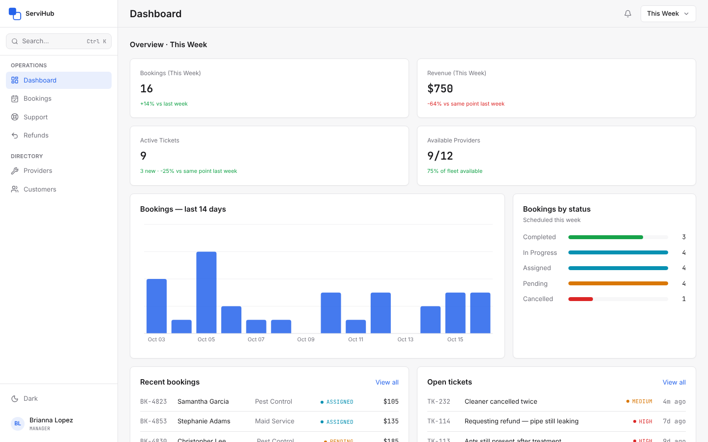
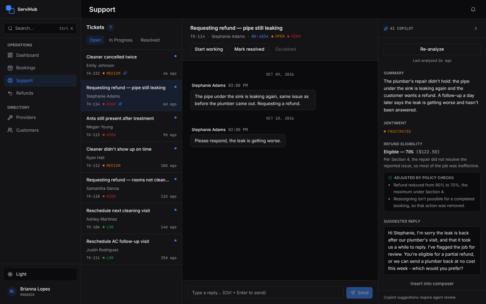
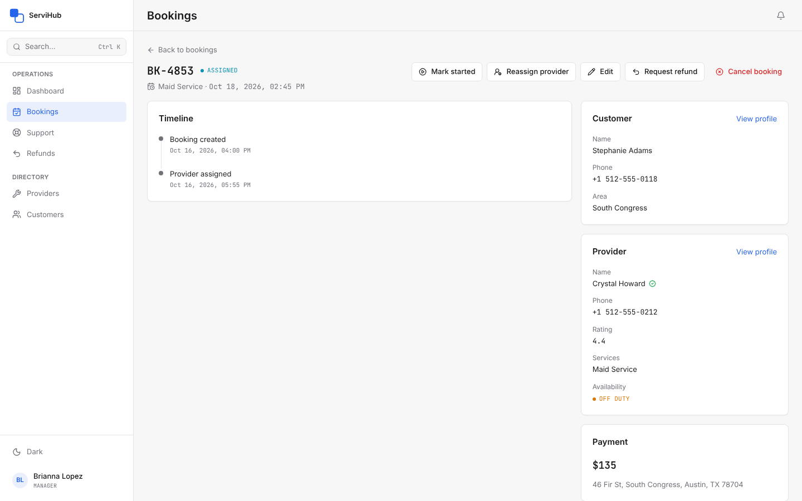
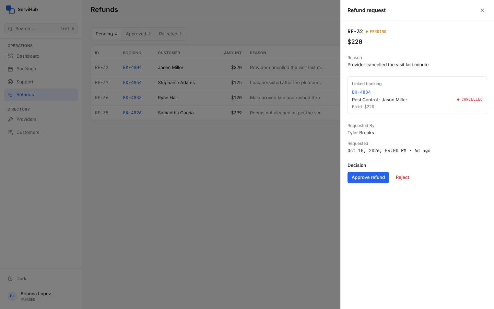

# ServiHub

Internal admin panel for a home-services marketplace (AC repair, plumbing,
electrical, deep cleaning, maid service, pest control). Staff manage
bookings, providers and customers, answer customer chats in real time with
an AI Copilot beside them, and run refunds through a request → approval
workflow. Each role sees only what it is allowed to.



| Support with the AI Copilot (dark mode) | Booking detail |
|---|---|
|  |  |



## Features

- **Dashboard**: bookings, revenue, tickets and provider availability for
  today, this week or this month in the viewer's time zone, with deltas
  against the previous period, a booking trend, status breakdown, and lists
  of recent bookings, open tickets and pending refunds (by role).
- **Bookings**: search, filter, sort and paginate; create bookings for
  customers; edit, start, complete, reassign or cancel them, with every rule
  (status, service match, provider availability, refunded amounts)
  enforced by the API and recorded on a timeline.
- **Providers and customers**: searchable directories with profiles, history
  and computed stats; add and edit records.
- **Live support**: three-pane workspace (queue, conversation, Copilot) over
  Socket.IO, with typing indicators, unanswered markers, start / resolve /
  reopen / escalate, and a public customer simulator to play the customer.
- **AI Copilot** (Groq): summary, sentiment, refund eligibility citing the
  written refund policy, a suggested reply and next actions. Server-side
  guardrails cap refunds to what the cited policy section allows and
  remove actions the booking can't take, so a prompt-injected message
  can't talk it into "100% refund".
- **Refunds**: request from the Refunds page, a booking or a Copilot
  suggestion; approve or reject with an optional note. Amounts can never
  exceed what is still refundable, and approvers and requesters are
  notified live.
- **Team and accounts**: invite members by link (emailed through Resend when
  configured), change roles, disable accounts (signs them out everywhere at
  once), reset forgotten passwords, change your own password, sign out of
  every device, "Keep me logged in", Google sign-in for existing staff.
- **Everywhere**: role-based access from one permission map, global search
  (Ctrl/Cmd + K) with deep links, in-app notifications, light and dark
  themes, and layouts that work down to phone width.

## Tech stack

| | |
|---|---|
| API (`servihub-api/`) | Node 20.19+, Express 5, Mongoose 9 (MongoDB), zod 4, Socket.IO 4, JWT in httpOnly cookies, Groq SDK, Resend |
| Admin app (`Servicehub-admin/`) | React 19, Vite 8, Tailwind CSS 4, TanStack Query 5, React Router 7, Recharts, socket.io-client |
| Tests | Vitest everywhere; supertest and a real MongoDB for the API; Testing Library for the app; GitHub Actions CI |

## Repository layout

```
.
├── README.md                 # this file
├── CONTEXT.md                # full project context: architecture, decisions, status
├── docs/screenshots/
├── .github/workflows/ci.yml  # lint + tests for both apps, plus the app build
├── servihub-api/             # REST + Socket.IO backend
│   ├── README-API.md         # endpoint, socket event and error-code reference
│   ├── SECURITY.md           # sessions, RBAC matrix, AI guardrails, known limitations
│   ├── src/                  # config, middleware, routes, controllers, services, models, sockets, seed
│   ├── tests/                # unit + integration tests
│   └── scripts/              # rbac-audit.mjs, e2e-journey.mjs (live API checks), create-admin.mjs
└── Servicehub-admin/         # React admin app
    ├── CLAUDE.md             # design system and frontend conventions
    └── src/                  # pages, layouts, components/ui primitives, hooks, contexts, lib
```

## Run it locally

You need **Node.js 20.19+** and a **MongoDB** server (local, Docker, or a
free MongoDB Atlas cluster). A standalone server is enough.

```bash
# 1. API
cd servihub-api
cp .env.example .env
# Fill in MONGODB_URI, and set JWT_ACCESS_SECRET and JWT_REFRESH_SECRET to two
# different random values:
#   node -e "console.log(require('crypto').randomBytes(48).toString('hex'))"
npm install
npm run seed        # wipes and reseeds the database (dates move to today)
npm run dev         # http://localhost:5000

# 2. Admin app, in a second terminal
cd Servicehub-admin
cp .env.example .env    # VITE_API_URL=http://localhost:5000/api
npm install
npm run dev         # http://localhost:5173
```

Open http://localhost:5173. The app's origin must be listed in the API's
`CLIENT_URL` (it is by default).

### Demo accounts

Every seeded account uses the password **`Demo@1234`**. With demo mode on
(the default outside production) the sign-in page also has one-click demo
access per role.

| Role | Email | Can |
|---|---|---|
| Super Admin | ammar.khan@servihub.com | everything, including the team |
| Manager | brianna.lopez@servihub.com | operations, support, refunds, directories |
| Support Agent | madison.carter@servihub.com | support, bookings (read-only), refund requests |
| Finance | jessica.nguyen@servihub.com | bookings (read-only), refund approvals |

To try live support, open http://localhost:5173/simulator in another
window, pick a customer and send a message: it appears in the Support queue
at once, and agent replies come back the same way.

### Optional integrations

The app runs without any of them; each feature then explains that it isn't
configured.

| Variable (`servihub-api/.env`) | Enables |
|---|---|
| `GROQ_API_KEY` | AI Copilot analysis ([console.groq.com](https://console.groq.com/keys)) |
| `GOOGLE_CLIENT_ID` | "Sign in with Google" for existing staff |
| `RESEND_API_KEY`, `EMAIL_FROM` | Password-reset and invitation emails. Without them, development prints each email and its link to the API console, and invitations always show the link to the admin who sent them. In production, "Forgot password" needs it. |

Every variable is described in `servihub-api/.env.example`.

## Tests and checks

```bash
# API
cd servihub-api
npm run lint
npm test            # unit + integration tests
```

Integration tests need MongoDB: by default `mongodb-memory-server`
downloads a binary on first run; set `MONGODB_TEST_URI` to use an existing
server instead (CI uses a `mongo:7` service). Each test file gets its own
throwaway database.

```bash
# Admin app
cd Servicehub-admin
npm run lint
npm test
npm run build
```

With the API running and seeded (demo mode on):

```bash
cd servihub-api
npm run audit:rbac  # every protected endpoint × 4 roles + anonymous; changes nothing
npm run e2e         # full staff + customer journey; writes data, so re-seed afterwards
```

CI runs lint and tests for both apps (and the production build of the app)
on every push and on pull requests to `main` and `demo/bug-showcase`.

## Deploying

Nothing here is tied to a host. For a real deployment:

- `NODE_ENV=production`, and leave `DEMO_MODE` unset (or `false`): it
  disables password-less demo login and the public customer simulator.
- Fresh, different `JWT_ACCESS_SECRET` / `JWT_REFRESH_SECRET`; never reuse
  development values.
- `CLIENT_URL` set to the app's real origin, and `VITE_API_URL` to the
  API's public URL when building the app (`npm run build` → static `dist/`).
- Serve both over HTTPS. Keep them on one site (e.g. `app.example.com` and
  `api.example.com`) so `COOKIE_SAMESITE=lax` works; unrelated domains need
  `COOKIE_SAMESITE=none`.
- `TRUST_PROXY` = the number of proxies in front of the API.
- Set `RESEND_API_KEY` and an `EMAIL_FROM` on a domain verified with Resend,
  or "Forgot password" can't deliver its link. (Invitations still work: the
  inviting admin always sees the link.)
- Run a single API instance for now: session caches and rate limits live
  in memory (see `servihub-api/SECURITY.md` → Known limitations).
- Don't run `npm run seed` there (it wipes the database). Create the first
  super admin instead, then invite everyone else from Settings → Team:

  ```bash
  cd servihub-api
  npm run create-admin -- --email you@company.com --name "Your Name"
  # prints a single-use link (valid 7 days) to choose the password
  ```

  Run it again for an existing email to restore that account as an active
  super admin with a fresh password link (useful after a lock-out).

## Documentation

- [CONTEXT.md](CONTEXT.md): how the whole project fits together, the
  decisions behind it and its current status.
- [servihub-api/README-API.md](servihub-api/README-API.md): endpoints, socket
  events, error codes, rate limits.
- [servihub-api/SECURITY.md](servihub-api/SECURITY.md): sessions and tokens,
  permission matrix, simulator scoping, AI guardrails, known limitations.
- [Servicehub-admin/CLAUDE.md](Servicehub-admin/CLAUDE.md): design system and
  frontend conventions.
